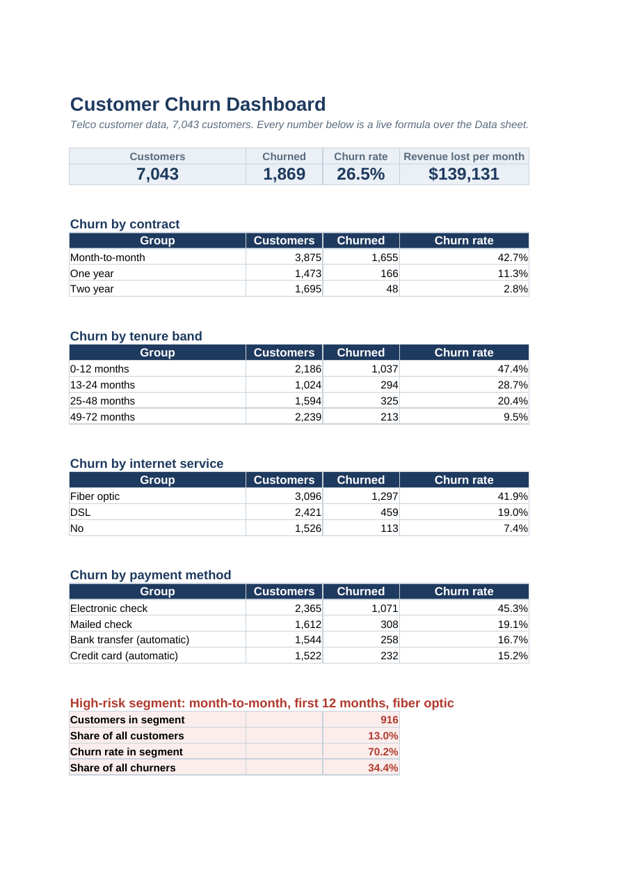

# Customer Churn Analysis

Why do telecom customers leave, and who should a retention team focus on first?

This project uses SQL to find the drivers of churn in 7,043 customer records, then turns the results into an Excel dashboard with retention recommendations.

**Tools:** SQL (SQLite), Python (pandas), Excel (COUNTIFS, SUMIFS, charts)

## Key findings

| Metric | Result |
| --- | --- |
| Customers | 7,043 |
| Churned | 1,869 (26.5%) |
| Monthly recurring revenue lost | $139,131 |
| High-risk segment | 916 customers (13.0% of the base) |
| Churn rate in high-risk segment | 70.2% |
| High-risk segment's share of all churners | 34.4% |

1. **Contract type is the strongest driver.** Month-to-month customers churn at 42.7%, versus 11.3% on one-year and 2.8% on two-year contracts.
2. **The first year is the danger zone.** Customers in their first 12 months churn at 47.4%. After four years it falls to 9.5%.
3. **Fiber optic customers leave most** (41.9%) even though they pay the most, about $91.50 a month on average.
4. **Support services keep customers.** Internet customers with neither tech support nor online security churn at 49.0%. With both, churn is 9.0%.
5. **Payment method matters.** Electronic check payers churn at 45.3%, versus 15-17% for automatic payments.

**The high-risk segment** is month-to-month, first 12 months, fiber optic. It is 13% of customers but a third of all churn, so it is where retention spending pays off first.

## Recommendations

| Finding | Recommendation |
| --- | --- |
| Month-to-month churn is 4x the one-year rate | Offer an incentive to move first-year month-to-month customers onto a one-year contract |
| Nearly half of first-year customers leave | Run a first-90-days onboarding program with check-ins |
| High-risk segment drives 34% of churn | Target this segment first with retention offers |
| Fiber customers churn most despite paying most | Review fiber pricing and service quality; survey leavers |
| No support services means 5x the churn | Include tech support and online security free for the first 6 months |
| Electronic check payers churn most | Offer a small credit for switching to automatic payment |

## Project structure

```
customer-churn-analysis/
├── data/telco_customer_churn.csv      raw data (7,043 rows, 21 columns)
├── sql/churn_analysis.sql             10 analysis queries
├── src/run_analysis.py                loads data, runs SQL, builds the Excel dashboard
└── outputs/
    ├── churn_dashboard.xlsx           Dashboard, Recommendations and Data sheets
    └── query_results/                 one CSV per SQL query
```

## SQL techniques used

- Aggregation with `GROUP BY`, `COUNT`, `SUM`, `AVG`
- Conditional counts with `CASE WHEN` to compute churn rates
- Bucketing tenure into bands with `CASE`
- `HAVING` to keep only groups with enough customers
- Subqueries for share-of-total and above-average comparisons

Example, churn rate by contract:

```sql
SELECT
    contract,
    COUNT(*) AS customers,
    ROUND(100.0 * AVG(CASE WHEN churn = 'Yes' THEN 1.0 ELSE 0 END), 1) AS churn_rate_pct
FROM customers
GROUP BY contract
ORDER BY churn_rate_pct DESC;
```

## The Excel dashboard



`outputs/churn_dashboard.xlsx` has three sheets:

- **Dashboard:** KPI tiles, churn breakdowns by contract, tenure, internet service and payment method, bar charts, and the high-risk segment. Every number is a live `COUNTIFS` or `SUMIFS` formula over the Data sheet, so it updates if the data changes.
- **Recommendations:** each finding paired with a retention action.
- **Data:** the full customer table with filters.

## How to run

```bash
pip install pandas openpyxl
python src/run_analysis.py
```

The script prints every query result and rewrites the outputs folder. Open the workbook in Excel to see the calculated values.

## Data cleaning

- `TotalCharges` was blank for 11 customers with 0 months of tenure. These were set to 0.
- `SeniorCitizen` was converted from 1/0 to Yes/No.
- Column names were converted to snake_case for SQL.

## Data source

IBM Telco Customer Churn sample dataset, from IBM's public [telco-customer-churn-on-icp4d](https://github.com/IBM/telco-customer-churn-on-icp4d) repository. It is a fictional dataset published by IBM for learning and demonstration.
